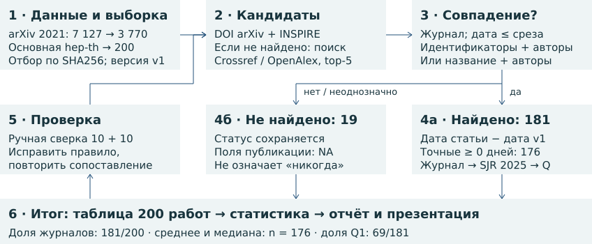

# Путь статьи: от arXiv к журналу

Исследование **200 препринтов hep-th за 2021 год**. Срез данных — **5 ноября 2026 года**.

**181/200 (90,5%)** получили журнальную версию; средняя задержка по 176 точным датам — **200,85 дня**, медиана — **140 дней**; **69/181 (38,1%)** публикаций вышли в журналах Q1.

## Итоговые материалы

1. **[Краткий отчёт](report.pdf)**: методика, итоги и контрольные примеры.
2. **[Итоговая таблица](preprints.csv)**
3. **[Презентация](presentation.pdf)**

Методика и основные результаты — в отчёте.

## Что лежит в репозитории

| Каталог / файл | Назначение |
|---|---|
| `results/` | Дополнительные таблицы и проверочные результаты |
| `src/` | Инструменты сбора данных и проверки целостности |
| `tests/` | Проверки расчётов и файлов сдачи |
| `docs/` | Инструкции по сбору, точности дат и сравнению результатов |

Данные, статьи, шрифты и сторонние пакеты сохраняют лицензии правообладателей.

## Повторный сбор и пересчёт

`make verify` сверяет замороженные результаты с контрольными хешами, а `make refresh` собирает новый снимок в отдельный каталог `data/live/`. Сбор использует API arXiv, INSPIRE-HEP, Crossref и OpenAlex, опубликованные данные SJR 2025, а также прямой HTTP-запрос к первичной странице издателя для точной даты Acta Physica Polonica B.

Новый снимок не заменяет материалы сдачи автоматически. Сначала сравните его CSV, даты и показатели с текущими результатами; новые материалы отчёта и презентации сохраняйте отдельно до проверки различий. Сохранённые сырые ответы и метаданные их происхождения остаются частью исходного набора.

Подробные правила сбора, проверки дат и сравнения итогов приведены в [инструкции проекта](docs/WORKFLOW.md).
