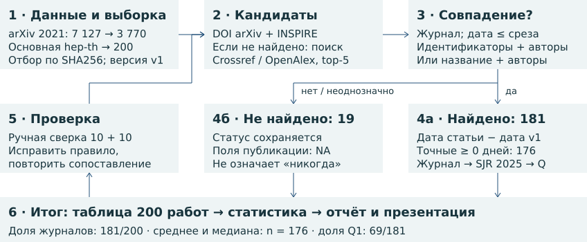
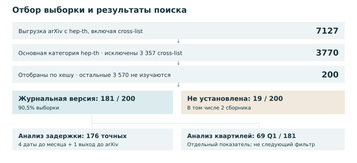
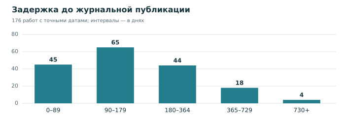
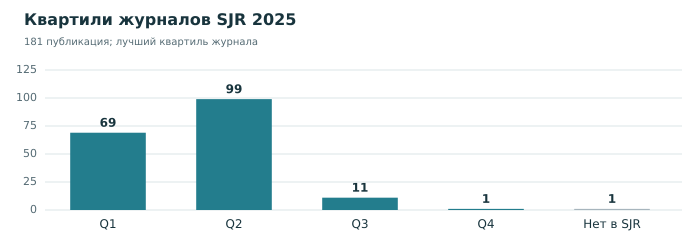

# Путь статьи: от препринта к журналу

Теоретическая физика высоких энергий (hep-th) · первые версии за 2021 год · данные на 05.11.2026

Для 200 случайных препринтов оценены доля журнальных публикаций, срок выхода и доля Q1.

## Главные результаты

| Показатель | Результат |
|---|---|
| Вышли в журналах | 181 из 200 · 90,5% |
| Время до публикации | В среднем 200,85 дня; медиана 140 дней |
| Вышли в журналах Q1 | 69 из 181 · 38,1% |

Среднее и медиана — по 176 точным задержкам. Q1 — верхняя четверть журналов SJR; доля Q1 среди всех 200 работ — 34,5%, среди опубликованных — 38,1%.

## Как проведено исследование

**Отбор.** Сортировать arXiv ID основной hep-th за 2021 год по SHA256("hep-th-2021-publication-study-v1:" + ID); взять первые 200. Сохранить дату UTC, авторов и название v1, а также последнее название. Для ненайденных версий взять top-5 Crossref и OpenAlex по каждому из двух названий; DOI раскрыть через Crossref (при отсутствии записи — метаданные INSPIRE).

**Правило совпадения.** Нормализовать регистр, диакритику (включая ł → l), формулы и пунктуацию. A = общие фамилии / число фамилий меньшего множества. Dice = 2|X ∩ Y|/(|X| + |Y|) для множеств слов. T = 0,65 × Dice + 0,35 × SequenceMatcher строк (autojunk=False); взять максимум для v1 и последнего названия. S = 0,75T + 0,25A. Прямая связь: A ≥ 0,5; для DOI arXiv также T ≥ 0,45, для связи INSPIRE по arXiv ID порога T нет. Поиск по названию: T ≥ 0,88, A ≥ 0,5, S ≥ 0,85; отрыв от следующего журнального кандидата с A ≥ 0,5 — не менее 0,05. Приоритет: прямая связь, затем S, затем DOI по алфавиту.

**Фильтры и расчёт.** Только journal-article; исключить исправления, ретракции, сборники и refereed=false. Дата должна быть известна и весь её интервал — не позже 05.11.2026. Приоритет даты: исходный imprint при смене DOI; явная online-дата издателя; online Crossref; точный imprint INSPIRE; published / published-print / issued Crossref; неполный imprint. created/deposited не использовать. Задержка — дата статьи минус дата v1: 4 неполные даты дают интервалы, 1 отрицательная разность хранится отдельно; в среднем только 176 точных неотрицательных значений. SJR 2025: ISSN/eISSN, иначе точное нормализованное название; лучший квартиль, при отсутствии — NA.

<!-- pagebreak -->

## Что показала ручная проверка

Отдельно выбраны и проверены 10 работ, для которых программа нашла статью, и 10, для которых не нашла. Сверены arXiv, INSPIRE и данные издателей. Найдена **1 ошибка из 20**: фамилии Pawelczyk и Pawełczyk программа приняла за разные и пропустила статью. После исправления обработки буквы ł осталось **0 ошибок на тех же 20 работах**. Это повторная проверка после исправления, поэтому она не доказывает отсутствие ошибок во всей выборке.

## Контрольные примеры: три найденные статьи и два трудных случая

| Особенность случая | Результат и подтверждение |
|---|---|
| Смена названия | [Препринт 2105.01130](https://arxiv.org/abs/2105.01130) → [статья в Classical and Quantum Gravity](https://doi.org/10.1088/1361-6382/ac51e7), 03.03.2022. Название изменилось; связь подтверждена по arXiv ID. |
| Смена названия и проверка даты | [Препринт 2112.15592](https://arxiv.org/abs/2112.15592) → [статья в Acta Physica Polonica B](https://www.actaphys.uj.edu.pl/R/54/6-A2), 11.07.2023. Название изменилось; дата проверена в тексте статьи. |
| Нет DOI в arXiv | [Препринт 2104.11336](https://arxiv.org/abs/2104.11336) → [статья в SciPost Physics Core](https://scipost.org/SciPostPhysCore.4.3.020), 09.09.2021. DOI найден в INSPIRE по arXiv ID. |
| Похожие работы | [Препринт 2107.01371](https://arxiv.org/abs/2107.01371). У похожих работ другие авторы или arXiv ID. Совпадения отклонены; журнальная версия не найдена. |
| Два названия, нет статьи | [Препринт 2104.14434](https://arxiv.org/abs/2104.14434). Is quantum time the classical time? сменилось на Quantum f(R) gravity and AdS/CFT. Проверены оба названия и INSPIRE; журнальная версия не найдена. |

## Пять спорных случаев: что решено и почему

**1. Изменился DOI — [2111.05295](https://arxiv.org/abs/2111.05295).** У статьи появился новый DOI. В новой записи Crossref указано 01.01.2021, а в исходных данных издателя, сохранённых в INSPIRE, — 28.12.2021. Принята дата 28 декабря; новый DOI сохранён. Для расчёта использована исходная дата выхода.

**2. Статья вышла до arXiv — [2109.03271](https://arxiv.org/abs/2109.03271).** [Издатель](https://www.mdpi.com/2624-8174/3/3/35) указывает 02.08.2021, первая версия arXiv подана 07.09.2021. Статья учтена как опубликованная. Разность −36 дней сохранена отдельно, но исключена из среднего времени ожидания после препринта.

**3. Найден сборник, а не журнал — [2104.03350](https://arxiv.org/abs/2104.03350).** Доклад вышел в [PoS ICHEP2020](https://pos.sissa.it/390/042/). В Crossref он отмечен как материал конференции. По выбранному правилу в долю журнальных публикаций он не входит; в расчёте со сборниками учитывается.

**4. Известен только месяц — [2102.02253](https://arxiv.org/abs/2102.02253).** Статья вышла в Nuclear Physics B в ноябре 2021 года. Задержка составляет 271–300 дней. Точное значение не указано: подстановка первого числа месяца создала бы ложную точность.

**5. Разное написание фамилии — [2111.07453](https://arxiv.org/abs/2111.07453).** У Pawelczyk и Pawełczyk совпадают название статьи, университет и DOI. Это один автор. После исправления сравнения фамилий статья найдена: она вышла 03.06.2022, через 201 день. Именно этот пропуск обнаружен при проверке 20 работ.

## Вывод и границы результата

К дате сбора журнальная статья найдена примерно у девяти из десяти препринтов этой выборки. «Не найдено» не значит «никогда не опубликовано»: оставшиеся работы могут выйти позже или отсутствовать в изученных базах. Метод также может пропустить статью, если название сильно изменилось и нет связи по идентификаторам, либо один препринт разделился на несколько статей.

Средняя задержка описывает только найденные публикации с точными датами; это не время рецензирования. Квартиль характеризует журнал и не даёт оценки качества отдельной статьи. Журналы добавляют экспертную проверку, редакционную ответственность и официальную версию для цитирования.

Источники: [arXiv](https://arxiv.org), [INSPIRE-HEP](https://inspirehep.net), [Crossref](https://www.crossref.org), [OpenAlex](https://openalex.org), издатели; SJR 2025 — сохранённые копии справочника SCImago. Таблица: results/preprints_ru.csv. Пересчёт: make reproduce в корне проекта (Python 3.12, Linux x86_64, make; без сети). Подробная методика и проверки — в полном отчёте results/report.pdf (приложения А–Е) и коде.

<!-- pagebreak -->

# Приложение А · Как получена выборка

Первые две страницы — краткий отчёт по заданию. Приложение раскрывает правила расчёта и проверки, чтобы исследование можно было понять и повторить без устной защиты. Все результаты относятся к замороженному срезу 05.11.2026.

## 1. Исследовательский вопрос и единица наблюдения

Какая доля препринтов теоретической физики высоких энергий (hep-th), впервые поданных в 2021 году, имеет журнальную версию к срезу? Сколько календарных дней проходит от подачи первой версии до выхода статьи и какая доля публикаций приходится на Q1? Единица наблюдения — один arXiv ID без суффикса версии. Результат относится к этой категории и когорте.

## 2. Полная выгрузка, затем отбор

Запрос Atom API: **cat:hep-th AND submittedDate:[202101010000 TO 202112312359]**. Загружаются все страницы по 1 000 записей, последняя — неполная; проверяются общее число и отсутствие дубликатов. Поле published задаёт первую подачу, updated — последнее обновление. Cross-list означает, что hep-th указана дополнительной категорией; такие записи исключаются фильтром primary_category == hep-th.

Получены 7 127 записей; 3 357 исключены фильтром основной категории, остаются 3 770. Для каждого ID вычисляется SHA256 от строки **hep-th-2021-publication-study-v1:**, непосредственно дополненной ID (например, 2105.01130), в UTF-8. Хеши сортируются лексикографически; берутся первые 200 без возвращения. Остальные 3 570 не входят в выборку по правилу отбора, а не из-за публикационного исхода. При допущении равномерности хеша это воспроизводимый псевдослучайный отбор.

Дата и исходное название дополнительно сверяются с метаданными v1. Название последней версии сохраняется отдельно для поиска. Сортировка готовой таблицы по ID служит только удобству чтения. Ни DOI, ни журнал, ни квартиль не участвуют в отборе.

## 3. Что считается публикацией

Основное событие — вышедшая к срезу рецензируемая журнальная статья. Обзоры в журналах включены; сборники, диссертации, главы, новые препринты и исправления вместо исходной статьи исключены. Явный refereed=false в INSPIRE запрещает принятие. У 180 принятых статей указан refereed=true; у одной Communications Physics флаг отсутствует, поэтому сохранена политика рецензирования журнала.

Это определение выбрано для единообразного сравнения в hep-th. Два подтверждённых сборника показаны отдельно: 181/200 = 90,5% по журнальному определению; (181 + 2)/200 = 91,5% при включении сборников. Разница в 1 процентный пункт характеризует чувствительность к определению.

<!-- pagebreak -->

# Приложение Б · Воронка и пути поиска

Схема показывает числа наблюдений, а не ширину пропорциональной воронки. Отбор 200 из 3 770 отделён от поиска публикаций: это разные действия.

## Почему одного DOI в arXiv недостаточно

| Исходная ветвь | Журнал найден | Не установлен | Всего |
|---|---|---|---|
| DOI указан в arXiv | 161 | 1 | 162 |
| DOI в arXiv отсутствует | 20 | 18 | 38 |
| Итого | 181 | 19 | 200 |

Точная запись INSPIRE найдена для всех 200 ID. DOI в arXiv или INSPIRE есть у 183 работ, но наличие DOI ещё не означает журнальную публикацию. Все 181 принятые связи в этой выборке подтверждены идентификаторами; резервный поиск по названиям новых положительных результатов не добавил. Он использован для проверки оставшихся случаев.

Из 19 исходов «журнальная версия не установлена» два имеют подтверждённые публикации в сборниках; остальные 17 не имеют принятой журнальной версии или такого подтверждённого сборника. Журнальная версия не найдена в проверенных источниках на 5 ноября 2026 года.

<!-- pagebreak -->

# Приложение В · Правила сопоставления

## 1. Построить список кандидатов

Из метаданных arXiv взять DOI и journal_ref как подсказки. В INSPIRE искать точный arXiv ID и проверять его наличие в найденной записи. DOI привести к нижнему регистру, разрешить документированные миграции и получить Crossref-запись. Для ненайденных версий сохранить первые пять результатов Crossref и OpenAlex по последнему названию и отдельно по v1, если название менялось. OpenAlex даёт кандидатов; тип и дата проверяются по регистрационной записи DOI. Кандидаты с одним DOI объединяются.

## 2. Проверить тип, дату и идентичность

Отклонить тип, отличный от journal-article, явный refereed=false, erratum/corrigendum/correction/retraction, отсутствие даты и дату после среза. При неполной дате её верхняя граница должна быть не позже среза. Затем проверить фамилии и название. Сильное переименование допустимо при точной связи arXiv в INSPIRE, но авторы всё равно сверяются.

## 3. Вычислить признаки

Нормализация удаляет HTML-разметку и оболочки LaTeX, приводит греческие обозначения к латинским именам, &amp; к and, убирает регистр и диакритику; специальные буквы преобразуются явно, например ł→l. Остаются латинские буквы и цифры, слова разделяются одним пробелом. Полная таблица преобразований находится в функции normalized в src/pipeline.py.

**D = 2|X ∩ Y| / (|X| + |Y|)**, где X и Y — множества слов названий.  **T = 0,65D + 0,35R**, где R — ratio Python difflib.SequenceMatcher по нормализованным строкам с autojunk=False. Берётся максимум T для названия v1 и последнего названия.  **A = |U ∩ V| / min(|U|, |V|)**, где U и V — множества нормализованных фамилий. При пустых данных сходство равно нулю. Для имени с запятой фамилия — часть до запятой, иначе последнее слово; в Crossref предпочтительно поле family.

## 4. Применить пороги и разрешить неоднозначность

Прямая связь требует A ≥ 0,5; если есть только DOI arXiv без точной связи INSPIRE, дополнительно T ≥ 0,45. Резервный поиск требует одновременно T ≥ 0,88, A ≥ 0,5 и S = 0,75T + 0,25A ≥ 0,85. Кандидаты ранжируются сначала по наличию прямой связи, затем по убыванию S, затем по DOI. Для резервного победителя отрыв от другого журнального кандидата с A ≥ 0,5, прошедшего прочие проверки, должен быть ≥ 0,05; иначе результат отклоняется как неоднозначный.

Пороги — открытые эвристики, их оптимальность не доказана. Высокая уверенность означает прямую связь, средняя — принятый резервный поиск, низкая — связь не установлена. В выборке: 181 / 0 / 19 соответственно. Флаг изменения названия сравнивает нормализованные строки без пробелов; 30 изменений включают небольшие редакционные правки. Это не число радикальных переименований.

<!-- pagebreak -->

# Приложение Г · Задержки и квартили

## Дата события и неполная точность

Начало — календарная UTC-дата подачи v1. Конец — published-online в Crossref; при отсутствии — самая ранняя точная дата imprint в INSPIRE; затем первое доступное поле Crossref в порядке published, published-print, issued; в конце — неполный imprint INSPIRE. Исходная точность сохраняется. created и deposited DOI не используются. Конфликты источников разрешаются явно: пример миграции DOI описан [на странице 2](#section-4). Дата принятия статьи не заменяет дату выхода.

**Задержка = дата первого выхода − дата v1**, в календарных днях. Для четырёх статей известны только месяц и год: это даёт интервал от первого до последнего дня месяца; точный delay_days остаётся NA. Одна статья вышла раньше arXiv: −36 дней сохранены в chronology.csv, публикация учитывается, но прямое ожидание не рассчитывается. Итак, из 181 статьи у 176 известны точные даты выхода после arXiv, у четырёх — только месяц; одна вышла до arXiv.

Рис. 1. Число работ в непересекающихся интервалах задержки; знаменатель — 176, единица по горизонтали — дни. Среднее 200,85 дня, медиана 140, диапазон 15–1 281. Длинные ожидания повышают среднее. Это описание завершённых переходов, а не оценка времени рецензирования и не среднее для всех 200 препринтов.

## Проверка чувствительности среднего

Среднее — сумма 176 точных задержек, делённая на 176; медиана — среднее двух центральных значений упорядоченного ряда. Если добавить четыре статьи с датами, известными только до месяца и сначала взять все нижние, затем все верхние границы, среднее для 180 прямых исходов лежит в 200,22–200,86 дня. Эти границы отражают точность дат, а не выборочную неопределённость.

<!-- pagebreak -->

# Приложение Д · Интерпретация результатов

Рис. 2. Число опубликованных работ по лучшему квартилю журнала в SJR 2025. «Нет данных» означает, что квартиль не установлен (NA в таблице данных). Один журнал может принимать много работ: здесь JHEP даёт 76 из 181 публикации и относится к Q2.

## Как получен квартиль и выбраны знаменатели

Журнал сопоставляется со справочником SCImago SJR 2025 по ISSN/eISSN; если ISSN отсутствует, используется точное нормализованное название. Берётся SJR Best Quartile, то есть лучший квартиль журнала по категориям. Это единый справочник за 2025 год, а не квартиль на год выхода каждой статьи. Неизвестный квартиль не заменяется Q4. Справочник сохранён из двух побайтно одинаковых зеркал, поскольку прямая выгрузка SCImago вернула 403; URL, коммиты и полные хеши находятся в docs/DATA_SOURCES.md и INPUTS.sha256.

| Показатель | Расчёт | Значение |
|---|---|---|
| Доля журнальных публикаций | 181 / 200 | 90,5% |
| Q1 среди опубликованных | 69 / 181 | 38,1% |
| Q1 среди всей выборки | 69 / 200 | 34,5% |
| Q1 среди имеющих квартиль | 69 / 180 | 38,33% |

## Что можно заключить

К срезу журнальная версия найдена примерно у девяти из десяти работ этой выборки. Интервал Уилсона 95% для 181/200 — 85,6–93,8%; он отражает случайный отбор, но не ошибки поиска. Для ненайденных версий полный срок до публикации неизвестен: это правое цензурирование. Наблюдение длится 1 770–2 131 день. Часть работ может выйти позже или уже существовать вне охвата источников. Объединение/разделение текстов и переименование без идентификаторов затрудняют поиск.

Поэтому нельзя переносить результат на все дисциплины или считать 19 работ доказанно неопубликованными. Квартиль характеризует журнал, а не отдельную статью. Журналы организуют рецензирование, редакционную ответственность, исправления и закрепление официальной версии; доступность препринта выполняет другую функцию — быстрое распространение результата.

<!-- pagebreak -->

# Приложение Е · Как проверить и повторить

## Ручная проверка и её границы

Исходные 10 положительных и 10 отрицательных предсказаний отобраны отдельным фиксированным хешем; их состав и исходные ответы сохранены в data/review/baseline_audit.json. Контрольные 3+2 и пять спорных случаев с решениями приведены [на странице 2](#section-4); подробные доказательства всех 29 уникальных случаев — в results/review_cases.md.

Обнаружен один ложный отрицательный ответ из 20: Pawelczyk / Pawełczyk. После исправления нормализации осталось 0/20, а на всём эталоне — 0/29. Эталон применялся при исправлении метода: это регрессионная проверка, а не независимая оценка точности. Отрицательные случаи проверены в доступных источниках; исчерпывающее отсутствие публикации этим не доказано.

## Воспроизведение сохранённого исследования

В корне полученного репозитория запустить **make reproduce**. Требования: CPython 3.12, Linux x86_64, glibc ≥ 2.27 и make; эталонная среда — Python 3.12.3 / Ubuntu 24.04. Зависимости исследования, презентации и шрифты включены в vendor. Команда проверяет INPUTS.sha256, пересчитывает все результаты, выполняет тесты и сверяет байты выходов с EXPECTED_RESULTS.sha256. Сеть и TeX не нужны.

| Что проверить | Где находится |
|---|---|
| 200 наблюдений, 11 колонок задания | results/preprints_ru.csv |
| ID и хеши отбора | results/sample.csv |
| Расширенные поля и источники | results/preprints.csv |
| Числа и этапы поиска | results/metrics.json; funnel.csv |
| Причины принятия и отказа | results/match_audit.json |
| Эталон и сверка с ним | data/review/gold.json; results/validation.json |
| Точность дат и хронология | results/quality.json; chronology.csv |
| Источники и словарь полей | docs/DATA_SOURCES.md; DATA_DICTIONARY.md |

## Новая выгрузка и смысл NA

**make refresh** запускает сетевой сбор в отдельный data/live/&lt;UTC timestamp&gt;/; API требуют доступной сети, страницы читаются через crawl4ai. Новый снимок требует отдельной проверки. Автономный пересчёт использует сохранённые ответы, а не текущее состояние внешних баз.

В таблице «нет» означает, что журнальная версия по принятому правилу не установлена. NA для журнала/DOI/даты у таких работ — неприменимость; NA для квартиля — неизвестный рейтинг; NA для точной задержки у опубликованной работы — неполная дата или обратная хронология. Эти причины различаются диагностическими полями расширенной таблицы. Пустой исход нельзя заменять нулём.
