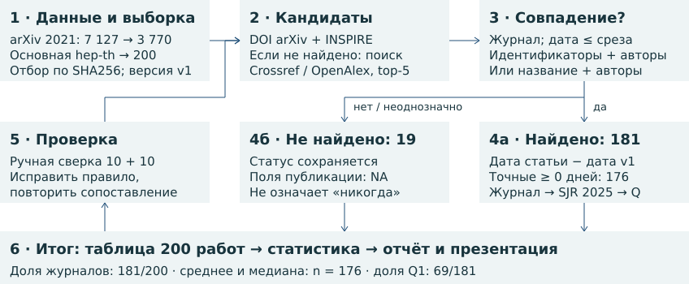

# Путь статьи: от препринта к журналу

Теоретическая физика высоких энергий (hep-th) · первые версии за 2021 год · данные на 05.11.2026

Для 200 случайных препринтов оценены доля журнальных публикаций, срок выхода и доля Q1.

## Главные результаты

| Показатель | Результат |
|---|---|
| Вышли в журналах | 181 из 200 · 90,5% |
| Время до публикации | В среднем 200,85 дня; медиана 140 дней |
| Вышли в журналах Q1 | 69 из 181 · 38,1% |

Среднее и медиана — по 176 точным задержкам. Q1 — верхняя четверть журналов SJR; доля Q1 среди всех 200 работ — 34,5%, среди опубликованных — 38,1%.

## Как проведено исследование

**Отбор.** Сортировать arXiv ID основной hep-th за 2021 год по SHA256("hep-th-2021-publication-study-v1:" + ID); взять первые 200. Сохранить дату UTC, авторов и название v1, а также последнее название. Для ненайденных версий взять top-5 Crossref и OpenAlex по каждому из двух названий; DOI раскрыть через Crossref (при отсутствии записи — метаданные INSPIRE).

**Правило совпадения.** Нормализовать регистр, диакритику (включая ł → l), формулы и пунктуацию. A = общие фамилии / число фамилий меньшего множества. Dice = 2|X ∩ Y|/(|X| + |Y|) для множеств слов. T = 0,65 × Dice + 0,35 × SequenceMatcher строк (autojunk=False); взять максимум для v1 и последнего названия. S = 0,75T + 0,25A. Прямая связь: A ≥ 0,5; для DOI arXiv также T ≥ 0,45, для связи INSPIRE по arXiv ID порога T нет. Поиск по названию: T ≥ 0,88, A ≥ 0,5, S ≥ 0,85; отрыв от следующего журнального кандидата с A ≥ 0,5 — не менее 0,05. Приоритет: прямая связь, затем S, затем DOI по алфавиту.

**Фильтры и расчёт.** Только journal-article; исключить исправления, ретракции, сборники и refereed=false. Дата должна быть известна и весь её интервал — не позже 05.11.2026. Приоритет даты: исходный imprint при смене DOI; явная online-дата издателя; online Crossref; точный imprint INSPIRE; published / published-print / issued Crossref; неполный imprint. created/deposited не использовать. Задержка — дата статьи минус дата v1: 4 неполные даты дают интервалы, 1 отрицательная разность хранится отдельно; в среднем только 176 точных неотрицательных значений. SJR 2025: ISSN/eISSN, иначе точное нормализованное название; лучший квартиль, при отсутствии — NA.

<!-- pagebreak -->

## Что показала ручная проверка

Отдельно выбраны и проверены 10 работ, для которых программа нашла статью, и 10, для которых не нашла. Сверены arXiv, INSPIRE и данные издателей. Найдена **1 ошибка из 20**: фамилии Pawelczyk и Pawełczyk программа приняла за разные и пропустила статью. После исправления обработки буквы ł осталось **0 ошибок на тех же 20 работах**. Это повторная проверка после исправления, поэтому она не доказывает отсутствие ошибок во всей выборке.

## Контрольные примеры: три найденные статьи и два трудных случая

| Особенность случая | Результат и подтверждение |
|---|---|
| Смена названия | [Препринт 2105.01130](https://arxiv.org/abs/2105.01130) → [статья в Classical and Quantum Gravity](https://doi.org/10.1088/1361-6382/ac51e7), 03.03.2022. Название изменилось; связь подтверждена по arXiv ID. |
| Смена названия и проверка даты | [Препринт 2112.15592](https://arxiv.org/abs/2112.15592) → [статья в Acta Physica Polonica B](https://www.actaphys.uj.edu.pl/R/54/6-A2), 11.07.2023. Название изменилось; дата проверена в тексте статьи. |
| Нет DOI в arXiv | [Препринт 2104.11336](https://arxiv.org/abs/2104.11336) → [статья в SciPost Physics Core](https://scipost.org/SciPostPhysCore.4.3.020), 09.09.2021. DOI найден в INSPIRE по arXiv ID. |
| Похожие работы | [Препринт 2107.01371](https://arxiv.org/abs/2107.01371). У похожих работ другие авторы или arXiv ID. Совпадения отклонены; журнальная версия не найдена. |
| Два названия, нет статьи | [Препринт 2104.14434](https://arxiv.org/abs/2104.14434). Is quantum time the classical time? сменилось на Quantum f(R) gravity and AdS/CFT. Проверены оба названия и INSPIRE; журнальная версия не найдена. |

## Пять спорных случаев: что решено и почему

**1. Изменился DOI — [2111.05295](https://arxiv.org/abs/2111.05295).** У статьи появился новый DOI. В новой записи Crossref указано 01.01.2021, а в исходных данных издателя, сохранённых в INSPIRE, — 28.12.2021. Принята дата 28 декабря; новый DOI сохранён. Для расчёта использована исходная дата выхода.

**2. Статья вышла до arXiv — [2109.03271](https://arxiv.org/abs/2109.03271).** [Издатель](https://www.mdpi.com/2624-8174/3/3/35) указывает 02.08.2021, первая версия arXiv подана 07.09.2021. Статья учтена как опубликованная. Разность −36 дней сохранена отдельно, но исключена из среднего времени ожидания после препринта.

**3. Найден сборник, а не журнал — [2104.03350](https://arxiv.org/abs/2104.03350).** Доклад вышел в [PoS ICHEP2020](https://pos.sissa.it/390/042/). В Crossref он отмечен как материал конференции. По выбранному правилу в долю журнальных публикаций он не входит; в расчёте со сборниками учитывается.

**4. Известен только месяц — [2102.02253](https://arxiv.org/abs/2102.02253).** Статья вышла в Nuclear Physics B в ноябре 2021 года. Задержка составляет 271–300 дней. Точное значение не указано: подстановка первого числа месяца создала бы ложную точность.

**5. Разное написание фамилии — [2111.07453](https://arxiv.org/abs/2111.07453).** У Pawelczyk и Pawełczyk совпадают название статьи, университет и DOI. Это один автор. После исправления сравнения фамилий статья найдена: она вышла 03.06.2022, через 201 день. Именно этот пропуск обнаружен при проверке 20 работ.

## Вывод и границы результата

К дате сбора журнальная статья найдена примерно у девяти из десяти препринтов этой выборки. «Не найдено» не значит «никогда не опубликовано»: оставшиеся работы могут выйти позже или отсутствовать в изученных базах. Метод также может пропустить статью, если название сильно изменилось и нет связи по идентификаторам, либо один препринт разделился на несколько статей.

Средняя задержка описывает только найденные публикации с точными датами; это не время рецензирования. Квартиль характеризует журнал и не даёт оценки качества отдельной статьи. Журналы добавляют экспертную проверку, редакционную ответственность и официальную версию для цитирования.

Источники: [arXiv](https://arxiv.org), [INSPIRE-HEP](https://inspirehep.net), [Crossref](https://www.crossref.org), [OpenAlex](https://openalex.org), издатели; SJR 2025 — сохранённые копии справочника SCImago. Таблица: results/preprints_ru.csv. Пересчёт: make reproduce в корне проекта (Python 3.12, Linux x86_64, make; без сети). Подробная методика и проверки — в полном отчёте results/report.pdf (приложения А–Е) и коде.
